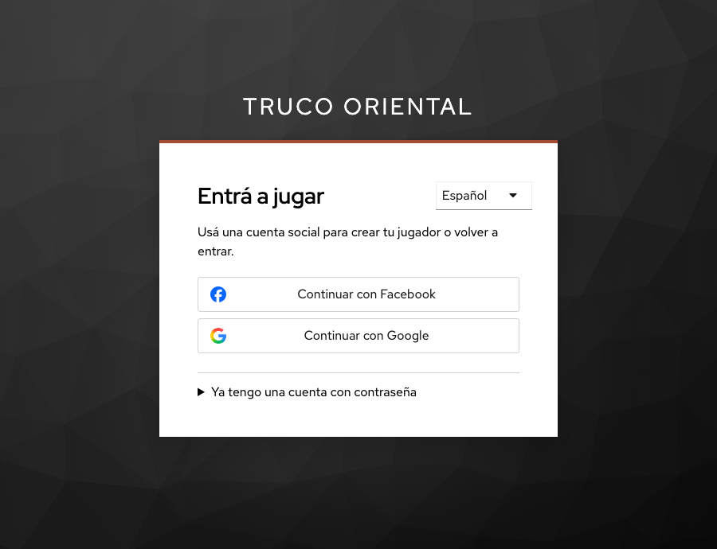

# Habilitar el ingreso con Google, Facebook y Discord

Al elegir **Ingresar al juego**, el jugador llega a **Entrá a jugar** en Keycloak. En eltru.co puede elegir **Continuar con Google** o **Continuar con Discord**. La pantalla muestra solo los proveedores habilitados. Quien ya tiene una contraseña puede desplegar **Ya tengo una cuenta con contraseña**. Si el entorno habilitó el registro por correo, también aparece el enlace para crear una cuenta. En producción, se habilita al [configurar el correo saliente](produccion.md#registro-con-correo-y-contraseña).



Podés habilitar uno de los proveedores y agregar el otro más adelante. Si todavía no habilitaste ninguno, Keycloak muestra el formulario de contraseña. La API recibe la identidad de Keycloak y emite su propia cookie de sesión.

## URLs que tenés que registrar

Google, Facebook y Discord devuelven el navegador a **Keycloak**. Copiá la URL de la fila correspondiente, incluido el puerto y sin agregar una barra al final.

| Proveedor | Compose local | Ejemplo para un entorno HTTPS |
| --- | --- | --- |
| Google | `http://localhost:8080/realms/mesa-local/broker/google/endpoint` | `https://identidad.example.org/realms/mesa/broker/google/endpoint` |
| Facebook | `http://localhost:8080/realms/mesa-local/broker/facebook/endpoint` | `https://identidad.example.org/realms/mesa/broker/facebook/endpoint` |
| Discord | `http://localhost:8080/realms/mesa-local/broker/discord/endpoint` | `https://identidad.example.org/realms/mesa/broker/discord/endpoint` |

En pruebas compartidas y producción, sustituí el dominio y el realm del ejemplo por los públicos de tu instalación. Podés confirmar el valor en **Identity providers → Google o Facebook → Redirect URI** de Keycloak. Luego Keycloak devuelve el navegador al **juego** en `/api/auth/callback`. Esa segunda dirección se registra en el cliente `truco-web` de Keycloak.

## Registrar el proveedor

### Google

1. En el proyecto de Google Cloud, abrí **Google Auth Platform → Branding**. Si es nuevo, elegí **Get started**, cargá **El Truco** como nombre del juego, el correo de soporte y el de contacto. Elegí la audiencia **External** para que puedan ingresar jugadores con cuentas personales. Usá proyectos separados para pruebas y producción. [Configurar Google Auth Platform](https://developers.google.com/workspace/guides/configure-oauth-consent)
2. En **Data Access**, usá solo `openid`, `email` y `profile`. En **Clients → Create client → Web application**, añadí el retorno de Google de la tabla en **Authorized redirect URIs**. Keycloak realiza el canje en el servidor y el campo **Authorized JavaScript origins** puede quedar vacío. Google admite HTTP en localhost para desarrollo. [Crear el cliente web](https://developers.google.com/identity/protocols/oauth2/web-server)
3. Guardá **Client ID** y **Client secret** como `GOOGLE_CLIENT_ID` y `GOOGLE_CLIENT_SECRET` en tu gestor de secretos. Para el lanzamiento, cambiá **Audience → Publishing status** a **In production** y completá los requisitos de marca que indique la consola. Con estos tres permisos Google permite probar sin cargar una lista de usuarios de prueba. [Audiencia y publicación](https://support.google.com/cloud/answer/15549945?hl=en)

### Discord

1. Creá la aplicación **El Truco** en el [portal de desarrolladores de Discord](https://discord.com/developers/applications) y agregá el retorno de la tabla en **OAuth2 → Redirects**. Usá aplicaciones separadas para pruebas y producción.
2. Guardá el **Client ID** y el **Client Secret** como `DISCORD_CLIENT_ID` y `DISCORD_CLIENT_SECRET`. El ingreso solicita únicamente `identify` y `email`; no necesita permisos de bot ni acceso a servidores. El nombre o correo pueden requerir que el jugador complete su perfil. [OAuth2 de Discord](https://docs.discord.com/developers/topics/oauth2)
3. Configurá el proveedor después de desplegar la versión de Keycloak incluida aquí. El alias `discord` usa OAuth v2 y el ID estable de Discord; mantené **Trust email** desactivado y verificá el vínculo a cuentas existentes mediante el método original.

### Facebook

El ingreso con Facebook está pausado en eltru.co. El comando de configuración habilita el proveedor, así que durante la pausa usalo solo en entornos de prueba.

1. En **Create App** de Meta, ingresá **El Truco** como nombre y el correo de contacto y elegí **Authenticate and request data from users with Facebook Login**. En **Use cases → Customize** habilitá `email` junto al `public_profile` incluido. El correo puede faltar si la persona no lo comparte o Facebook no tiene uno confirmado. [Crear la app en Meta](https://developers.facebook.com/documentation/development/create-an-app)
2. En los ajustes de **Facebook Login**, activá **Client OAuth Login** y **Web OAuth Login**. En **Valid OAuth Redirect URIs** cargá el retorno HTTPS de Facebook de la tabla con tu dominio y realm reales. Si Meta indica que ya admite `http://localhost` automáticamente en modo de desarrollo, probá el retorno local con una cuenta que tenga un rol en la app. Si lo rechaza, usá el entorno HTTPS de pruebas. [Ajustes del flujo web](https://developers.facebook.com/documentation/facebook-login/guides/advanced/manual-flow)
3. Copiá **App ID** y **App Secret** de **App settings → Basic** a `FACEBOOK_APP_ID` y `FACEBOOK_APP_SECRET` en tu gestor de secretos. Para probar antes de publicar, agregá al jugador como tester de la app y pedile que acepte la invitación. Para abrir el ingreso al público, cargá los enlaces de privacidad y eliminación de datos, completá la revisión y la verificación que indique el panel y elegí **Publish → Go live**. [Publicar la app](https://developers.facebook.com/documentation/development/release)

Para rotar el secreto, conservá el **App ID**, guardá el **App Secret** nuevo y volvé a ejecutar el comando de Facebook. Facebook identifica a cada jugador con un ID específico de la aplicación. [Identificadores de Facebook](https://developers.facebook.com/docs/graph-api/overview)

## Activar en Keycloak

Exportá desde tu gestor de secretos las dos variables del proveedor elegido. Si preferís cargarlas a mano en Bash o Zsh, ejecutá solo la línea de ese proveedor. Pegá primero el ID, presioná Intro, pegá el secreto y presioná Intro otra vez. El secreto queda oculto al escribirlo y fuera del historial de comandos.

```sh
read -r GOOGLE_CLIENT_ID && read -rs GOOGLE_CLIENT_SECRET && export GOOGLE_CLIENT_ID GOOGLE_CLIENT_SECRET
read -r DISCORD_CLIENT_ID && read -rs DISCORD_CLIENT_SECRET && export DISCORD_CLIENT_ID DISCORD_CLIENT_SECRET
read -r FACEBOOK_APP_ID && read -rs FACEBOOK_APP_SECRET && export FACEBOOK_APP_ID FACEBOOK_APP_SECRET
```

**Compose local.** Para un volumen nuevo, creá un administrador temporal al primer arranque. Desde la raíz del proyecto, ejecutá en la misma terminal el arranque y el comando de cada proveedor que hayas registrado.

```sh
export KC_BOOTSTRAP_ADMIN_USERNAME=admin-social-local
export KC_BOOTSTRAP_ADMIN_PASSWORD="$(openssl rand -hex 24)"
docker compose up -d --wait
npm run auth:google
npm run auth:facebook
npm run auth:discord
```

Si el realm ya existe, ejecutá directamente `npm run auth:google` o `npm run auth:facebook`. Exportá un token administrativo vigente en `KEYCLOAK_ADMIN_TOKEN`, o las credenciales de un administrador de `master` en las dos variables `KC_BOOTSTRAP_ADMIN_*`. Keycloak solo crea la cuenta de arranque cuando inicializa `master` por primera vez.

Si perdiste el acceso administrativo, estos comandos permiten crear un administrador temporal sobre el mismo volumen. Usá sus credenciales para ejecutar el comando del proveedor. Una vez establecido el acceso permanente, eliminá la cuenta temporal. [Recuperar el acceso administrativo](https://www.keycloak.org/server/bootstrap-admin-recovery)

```sh
docker compose stop identidad
docker compose run --rm --no-deps identidad bootstrap-admin user
docker compose up -d --wait
```

**Keycloak propio o de producción.** Desde un equipo con acceso a la API administrativa, cargá `KEYCLOAK_ADMIN_URL` con la URL base de Keycloak (por ejemplo, `https://admin-identidad.example.org`), `KEYCLOAK_REALM` con el nombre del realm del juego y `KEYCLOAK_ADMIN_TOKEN` con un token de acceso de corta duración con permiso para administrar sus proveedores de identidad. Cargá también las variables del proveedor elegido. El proxy público de Compose expone los retornos de ingreso y reserva la administración para la red interna. Mantené los secretos en el entorno del proceso que configura Keycloak y fuera del repositorio. Ejecutá el comando correspondiente.

```sh
node scripts/configurar-ingreso-social.mjs google
node scripts/configurar-ingreso-social.mjs discord
```

## Activar la pantalla de El Truco

Con un volumen nuevo, Compose ya selecciona el nombre **El Truco** y el tema `truco-oriental` para el ingreso y la cuenta. El realm `mesa-local` ofrece español e inglés y usa español por defecto. Si el realm existe, Keycloak conserva su configuración al arrancar. Para actualizar la instalación local y elegir el tema sobre ese mismo volumen, ejecutá estos comandos. Reemplazá `admin-social-local` por tu administrador de `master` y escribí su contraseña cuando Keycloak la pida. [Importación al arrancar Keycloak](https://www.keycloak.org/server/importExport#_importing_a_realm_during_startup)

```sh
docker compose up -d --build --wait identidad
docker compose exec identidad /opt/keycloak/bin/kcadm.sh update realms/mesa-local -n \
  --no-config --server http://localhost:8080 --realm master --user admin-social-local \
  -s 'displayName=El Truco' -s loginTheme=truco-oriental -s accountTheme=truco-oriental \
  -s internationalizationEnabled=true \
  -s 'supportedLocales=["es","en"]' -s defaultLocale=es
```

En la imagen de Compose ya se incluyen el tema y su icono. Si instalás el tema por separado, copiá `infra/keycloak/truco-oriental` al directorio `themes` de cada servidor y `public/favicon.svg` a `login/resources/img/favicon.svg` y `account/resources/img/favicon.svg` dentro del tema.

En la consola administrativa, seleccioná el realm `mesa` en producción o `mesa-local` para el juego local. En **Realm settings → General**, guardá **El Truco** en **Display name** y dejá vacío **HTML Display name** para que el ingreso muestre ese mismo nombre. En **Realm settings → Themes**, elegí **truco-oriental** en **Login theme** y **Account theme**. En **Clients → truco-web → Settings**, guardá **El Truco** en **Name**. Si usás la cuenta de prueba del realm `truco-local`, actualizá también su nombre y sus temas. En **Realm settings → Localization**, activá **Internationalization**, agregá español e inglés a los idiomas disponibles y guardá español como predeterminado. El selector de idioma permite pasar de **Entrá a jugar** a **Sign in to play**. [Temas de Keycloak](https://www.keycloak.org/ui-customization/themes)

## Comprobar el ingreso y la vinculación

Abrí **Ingresar al juego** desde una ventana privada. Elegí el proveedor, completá el ingreso y anotá el ID de jugador. Cerrá sesión y volvé a entrar con la misma cuenta en otra ventana privada. Deberías recuperar el mismo ID y poder volver a tu mesa. Probá también cancelar en la pantalla del proveedor y volver a iniciar el ingreso.

Si el jugador entró primero con Google y después elige Facebook con el mismo correo, Keycloak puede pedirle que vuelva a ingresar con Google para verificar la cuenta existente. Al completar la vinculación, ambos botones deben llevar al mismo ID de jugador y a la misma mesa.

El comando que activa un proveedor conserva su flujo de primer ingreso y sus permisos si ya existía. Revisá los permisos y quitá los adicionales si solo usás el ingreso. Comprobá que el flujo exige demostrar el control de la cuenta antes de vincularla. Conservá **Trust email** desactivado. Si el correo de confirmación resulta insuficiente, configurá la verificación con el método de ingreso original. Si Facebook omite el correo y el realm lo exige, el jugador puede completarlo al revisar su perfil. La identidad del jugador se guarda por emisor y sujeto de Keycloak. [Vinculación de identidades en Keycloak](https://www.keycloak.org/docs/latest/server_admin/#_identity_broker)

## Habilitar Sign in with Apple

Apple exige este ingreso en la app porque ofrece Google y Discord. Hace falta el Apple Developer Program. Keycloak lo usa con la extensión comunitaria [`apple-identity-provider-keycloak`](https://github.com/klausbetz/apple-identity-provider-keycloak) 1.17.0, que la imagen de `infra/keycloak` incluye con su suma fija.

1. En [Certificates, Identifiers & Profiles](https://developer.apple.com/account/resources/identifiers/list), creá un **App ID** con la capacidad **Sign in with Apple**.
2. Creá un **Services ID** (por ejemplo `co.eltru.ingreso`) y activá **Sign in with Apple** en él. En **Website URLs**, el dominio es el público del juego y el **Return URL** es el de Keycloak, `https://<dominio>/realms/<realm>/broker/apple/endpoint`.
3. En **Keys**, creá una clave con **Sign in with Apple**, asociada al App ID. Descargá el archivo `.p8` (Apple lo entrega una sola vez) y anotá el **Key ID** y el **Team ID** de tu cuenta.
4. Configurá el proveedor:

   ```sh
   export APPLE_CLIENT_ID=co.eltru.ingreso APPLE_TEAM_ID=<Team ID> APPLE_KEY_ID=<Key ID>
   export APPLE_PRIVATE_KEY="$(cat AuthKey_<Key ID>.p8)"
   npm run auth:apple
   ```

La extensión firma el secreto con la clave en cada ingreso, así que no hay un secreto que venza. Keycloak guarda los tokens de Apple (`storeToken`) para que la API los revoque al eliminar una cuenta, como exige Apple. Apple entrega el nombre solo en el primer ingreso y puede ocultar el correo del jugador.

Si el jugador oculta su correo, Apple le da una dirección de retransmisión (`@privaterelay.appleid.com`) que solo acepta mensajes de remitentes registrados. Keycloak manda correos cuando el realm tiene SMTP: verificación, vinculación y recuperación. Para que lleguen, registrá el dominio y la dirección remitente de Keycloak en el servicio de retransmisión de Apple. [Configurar la retransmisión privada de correo](https://developer.apple.com/help/account/capabilities/configure-private-email-relay-service/)

### Notificaciones de Apple

Apple avisa al servidor cuando un jugador deja de usar su Apple ID con El Truco o elimina su cuenta de Apple. La API recibe esos avisos en `POST /api/auth/apple/notificaciones`.

En [Certificates, Identifiers & Profiles](https://developer.apple.com/account/resources/identifiers/list), abrí el App ID primario `co.eltru.app`, elegí **Configure** en **Sign in with Apple** y cargá como URL de notificaciones de servidor a servidor la de la API: `https://eltru.co/api/auth/apple/notificaciones` en producción. Guardá el App ID. [Habilitar las notificaciones de servidor a servidor](https://developer.apple.com/help/account/configure-app-capabilities/enabling-server-to-server-notifications)

La API necesita `APPLE_CLIENT_ID` y el cliente de servicio `truco-api` (`KEYCLOAK_API_CLIENT_SECRET`). Sin `APPLE_CLIENT_ID`, el endpoint responde 404.

Apple manda `{"payload": "<JWS>"}`. La API acepta la notificación si:

- La firma RS256 es de una de las claves de Apple (`https://appleid.apple.com/auth/keys`). La API las guarda un día y las vuelve a bajar ante una clave nueva. Si Apple no responde, usa las que ya tenía.
- `iss` es `https://appleid.apple.com`.
- `aud` es `APPLE_CLIENT_ID` (el Services ID) o el bundle `co.eltru.app`.
- `iat` tiene menos de 24 horas, con 5 minutos de tolerancia para el reloj.

Con el `sub` del evento, la API busca al usuario de Keycloak vinculado a `apple` y, con él, al jugador.

| Evento | Qué hace |
| --- | --- |
| `consent-revoked` | Cierra las sesiones del jugador en la API, sus conexiones en vivo y sus sesiones de Keycloak, y borra el token de Apple guardado. Conserva el vínculo: si vuelve a entrar con Apple, recupera su jugador. |
| `account-deleted` (antes `account-delete`) | Si Apple era su única forma de entrar, sin otro proveedor vinculado ni contraseña, empieza la misma baja que **Eliminar mi cuenta**: 30 días de gracia y después se anonimiza. Si tiene otra forma de entrar, quita el vínculo con Apple, borra el token y cierra sus sesiones. La cuenta sigue. |
| `email-disabled`, `email-enabled` | Solo se registran en el log. |

Respuestas:

- **200** para una notificación válida, aunque no haya jugador con ese `sub`.
- **400** si la firma o los claims no valen.
- **503** si Keycloak o las claves de Apple no responden, o si falta el cliente de servicio. Apple puede reintentar.

Repetir un evento no cambia nada. La API guarda durante 30 días un hash de cada evento aplicado (tipo, `sub` y `event_time`) en `juego.avisos_apple`. Así, un reenvío no cierra las sesiones que el jugador abrió después. El log registra el tipo y el resultado, sin el `sub` ni el correo.

En las pruebas, `APPLE_KEYS_URL` reemplaza la dirección de las claves de Apple, como `APPLE_REVOKE_URL` la de la revocación. Dentro de `npm run check:stack`, `scripts/verificar-notificaciones-apple.mjs` firma un aviso de cada tipo con una clave propia y comprueba su efecto en la base y en Keycloak. [Procesar los cambios en las cuentas de Sign in with Apple](https://developer.apple.com/documentation/signinwithapple/processing-changes-for-sign-in-with-apple-accounts)

## Ingreso desde la app

La app usa el mismo ingreso, sin cookie:

1. Genera un verificador aleatorio y abre en el navegador del sistema `/api/auth/login?app=<desafío>`, donde el desafío es el SHA-256 del verificador en base64url (S256, RFC 7636).
2. Al terminar el ingreso, la API redirige a `eltruco://ingreso?codigo=<código>`. El código vence a los 60 segundos y sirve una sola vez.
3. La app llama `POST /api/auth/canje` con `{"codigo", "verificador"}` y recibe `{"sesion", "jugador", "bajaCancelada"}`.
4. En cada pedido HTTP y en el WebSocket envía `Authorization: Bearer <sesion>`. Con ese encabezado la API no exige el encabezado `Origin`. La sesión dura 30 días y se renueva con el uso.

`POST /api/auth/logout` con el encabezado cierra esa sesión y sus conexiones en vivo.
